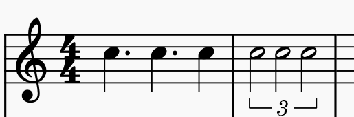

# 采音

在这一节中，我将介绍 Cytus II 中基本的采音准则。关于复杂声部的选轨策略、混合声部（混 FR）以及特殊音乐变化的处理，将在进阶篇的[对音与选轨](../Advanced/Accelerando.md)中进一步展开。

## 听歌与观察

在正式动笔摆放 Note 之前，听歌阶段最重要的任务是把握音乐的**表达重点**与**段落间变化**：

- 各个段落的配器发生了怎样的变化？
- 段落之间是什么关系，结构上哪些段落比较重要？
- 曲目中有没有标志性的特色音色？

此外，谱师自身的风格偏好也会在潜移默化中影响采音方向——例如是偏向简洁清晰的单轨表现，还是偏向穿插多个声部的混合采音。先在脑海中对全曲的声音层次建立印象，能避免动笔后陷入“听到什么放什么”的盲目状态。

## 准确

准确是 Cytus II 采音的第一要义。大部分情况下，Cytus II 谱面中的 Note 都需要和具体的音相对应，且摆放在正确的时间点上。

Note 和音乐发生偏差的现象称为 **zure**（ズレ，misalignment）。写谱过程中要尽量避免 zure 的产生。

### 对音方法与常见情境

把音采准需要一定的技术与经验。对于正常混音、正常节奏的曲目，一般开启 **0.5x 慢放**仔细听音都能采对；新手常常因为过于自信而不开慢放，或缺乏细致复查，从而留下大量本可避免的偏差。当多个声音叠加在一起暂时听不清时，同样可以通过慢放并**参考上下文**的规律来确认位置，一般不会出现完全无法判断的情况。

!!! info "采音技巧"
    Cylheim 自带的慢放功能可以有效地提高采音的准确性，建议在采音或检查时使用 0.5x 或更低的播放速度，并在播放速度面板中开启“保持音调”，避免慢放降调导致音高失真或低频模糊。此外，也可以利用 `F1`–`F4` 播放速度预置快捷键、右键速度按钮快速恢复 `1.00x`，以及设置中的“当前位置预览提前量”来提高反复听音的效率。

    

面对非均匀或非常规的节奏型时，需要针对不同情境分别处理：

- **12 分、24 分节奏**：需要清楚什么时候应当切换横向格线细分。面对三连音体系的节奏，继续使用 16 分系列格线去近似是徒劳的（可利用 Cylheim 的行格线预置快捷键快速切换）。
- **Swing（摇摆）节奏型**：首先要认识到 Swing 中相邻音符之间的间距本来就是**不均匀**的。人的心理预期会影响听感，采音时切忌先入为主地将其听成均匀的八分或十六分节奏。
- **变拍与变速**：遇到拍号或速度变化的段落，必须先把 BPM（Tempo）和页面长度（Pagesize）设置正确，再开始摆放 Note。
- **实录乐器与“微分音”**：这里的“微分音”泛指 7 分、10 分、20 分、56 分等非常规细分、BMS 谱面中常见的以 1/192 为单位的碎音，以及两个音时间间隔极小的伪双押（如装饰性的倚音）。处理这类声音时，可以寻找官谱、优秀自制谱或同曲 BMS 谱面作为参考，或者在合理范围内尽可能近似、作一定简化。

## 规律与取舍

采音绝不是把听见的声音简单堆叠起来。即便每一个 Note 都有对应的音、时间位置也完全准确，一张谱面的采音依然可能是不合格的——这往往出在**段落规律**与**声音取舍**上。

### 段落内的采音规律

一个最基础的要求来自段落结构：**在一个段落里，如果没有比较特殊的缘由，采音最好保持同一个音轨（或同一些音轨），并保持采音的逻辑近似。** 否则，玩家在游玩时完全看不出采音的规律，谱面与音乐之间的听觉联系就会变得支离破碎。

### 声音的取舍

听见了一个音、时间也能确定，但最终选择不采，这在写谱中是非常普遍的。Cytus II 作为双指游玩为基础的游戏，谱面最多同时处理 3～4 个音轨；如果不加取舍地把所有声音全部塞进谱面，只会造成读谱与手感的灾难。

即便在同一个音轨内部，不同强弱和音色的音也不一定需要全采。例如面对一段包含不同强弱、不同音色的鼓组，为了维持当前段落的预期难度，或者单纯因为空间与配置已经摆不下了，我们通常会选择其中较突出的一些或固定的一组来写，并在段落内维持这一取舍标准的一致性。

??? note "待补充：鼓音取舍与规律案例"
    后续将结合具体曲目片段，展示如何在同一鼓组轨道中挑选一组声音并形成可辨认的段落规律。

## 采空音（Dump）与简化边界

部分音游中存在名为 **dump（采空音）** 的技巧，即在没有实际声音的位置放置音符。在 Cytus II 中，我个人的态度是**基本不允许**采空音。

不过，在实际创作与社区实践中，有几类处于边界或属于合理简化的情形需要加以区分：

- **Vocal 人声或长音的密锁链**：针对连续的人声或长音，有人可以接受使用 8 分、16 分及以上密度的长锁链来表现。此时锁链的子节点并不实际对应独立的音头，其作用更接近 Arcaea 中的音弧。
- **密集采音的简化**：面对极高密度的音符（如 32 分音），有人会采用 24 分去近似处理；相比之下，我**更推荐直接用 16 分去写**——用 16 分处理 32 分并不是采偏（zure），而是有理由的**舍音**，在逻辑上更加干净合理。
- **细碎伪双押的简化**：对于装饰音、倚音等时间间隔极短的细碎伪双押，视情况将其简化为普通双押也是常见的处理方式。
