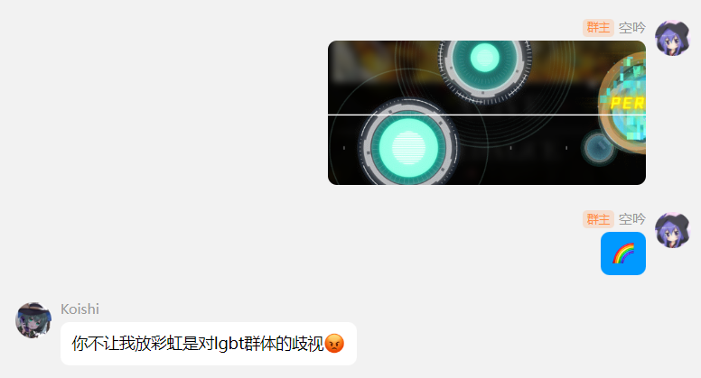

# 配置

如果说采音决定了谱面在“什么时间”响应“什么声音”，那么**配置**就决定了这些声音以怎样的 Note 类型、键型组合与空间位置呈现在玩家面前。

## 采音与配置的共同规划

虽然教程为了方便阐述将“采音”和“配置”分章讨论，但在 Cytus II 的实际写谱工作流中，我们通常不会把二者完全割裂开——**在摆放 Note 的同时，采音与配置往往是一起完成的**，而且在动笔之前就会对二者作共同规划。

假设一段音乐的大致采音方向和目标难度已经确定，在组织配置时，我们通常会综合考量以下三个方面：

| 考量维度 | 对配置写法的影响 | 常见体现 |
| --- | --- | --- |
| **难度预期** | 决定采音密度与配置强度 | 以 Click 为主还是以 Drag 为主；是否有必要使用二纵等加难配置 |
| **音轨音色** | 决定 Note 类型与形态倾向 | 如特色 Bass 导向复杂的 Drag 设计；特殊音效导向非常规配置 |
| **大结构与屏间关系** | 决定两屏之间的摆位方法与段落形态 | 统筹前后页的空间分配，处理跨屏衔接与遮挡关系 |

## Note 类型与音色表达

不同 Note 类型天然带有不同的操作反馈，如何根据音色选择 Note 是配置设计的基础。以电子音乐中常见的 **Bass** 音色为例：

- **扭动感与丰富变化**：当一段 Bass 具有明显的扭动感、音高与滤波变化比较丰富时，往往很适合用 **Drag** 的形状和走向去描绘。
- **颗粒感与厚重感**：许多带有明显颗粒感的 Bass 能够很好地支撑**密锁链**的表现；一些厚重的低频音色同样可以用锁链传达出扎实的质感。
- **锯齿与顺滑的形态区分**：在设计锁链形状时，偏尖锐、锯齿感的音色通常偏向**折线锁**；而偏圆润、顺滑的音色则偏向**弧线锁**。

当然，这并不是说所有 Bass 都必须写成 Drag。具体选择仍需结合当前的采音密度、预期难度以及前后文关系——部分短促或定点的 Bass 用 **Click** 或 **Hold** 来表达反而更加合适。

## 音轨区分与多音色组合

孤立地看，一个键型一般没有绝对的“对错”之分；判断一段配置是否合理，关键在于它如何表达当前音乐中的各个音色。

举一个新手非常容易踩坑的例子：假设在一小段音乐里，由**两个以上的不同音轨**交替拼出了完整的十六分节奏，如果你直接把它写成一段普通的均质十六分交互，这就足以构成**“错配置”**。

!!! warning "为什么会成为“错配置”？"
    十六分交互这个键型本身没有任何问题；错就错在**没有对不同音轨做配置区分**。当多个音色拼合在一起时，哪怕只是简单粗暴地做成“前 4 + 后 4”的区分都往往不够，更不用说用完全同质化的交互抹平所有音色的差异了。

由此可以引出配置设计的一条重要原则：**任意的多音色组合，都需要按照各个音色分别去设计。** 至于复杂声部交织时如何具体拆解配置，将在进阶篇的[键型与局部设计](../Advanced/Stringendo.md)中进一步讨论。

## 前后屏遮挡与两屏摆位

与下落式音游不同，Cytus II 的扫描线在页面间上下往返，前一页与后一页的 Note 会在交界处同时出现在画面中。如果摆位时只顾当前页、不考虑下一页，就极易造成严重的**前后屏遮挡**与读写冲突，这也是新手谱面最常见的硬伤之一。

因此，Cytus II 的摆位必须以“两屏关系”为单位来思考。常见的两屏摆位方法包括：

- **里外分布**：内上外下、内下外上；
- **分区分布**：左中右、左右对置；
- **交错分布**：穿插摆位、上二下三的五轨布局等。

通过有规律地错开前后两屏 Note 所占据的横向或纵向区域，既能彻底规避视觉遮挡，也能引导玩家的双手自然地完成跨页过渡。

??? note "待补充：基础两屏摆位图示与特殊配置边界"
    后续将补充典型两屏摆位方法的编辑器图示，以及诸如“Flick 八分内放置打击音符”等特殊配置成立的速度与手序条件。

## 音高摆位与走向表达

许多谱师在摆放旋律轨时会追求“按音高摆位”（例如音高越高、横坐标越偏右，或顺应旋律起伏移动位置）。但在实际创作中，**逐音严格对应的音高摆位往往是不可行的**，原因在于它同时受到多重现实条件的掣肘：

1. **前后屏遮挡与手序限制**：为了避开上一屏或下一屏的 Note，加上合理的左右手交替要求，常常导致两屏之中**只能在其中一半选择严格的音高摆位**。
2. **手感与可玩性限制**：一些连续起伏的音高如果强行全部用 Click 按音高幅度拉开，实际游玩起来会非常别扭且难打。
3. **多音轨冲突与难度控制**：音高只是配置需要表现的一部分，摆位同时还要兼顾不同音轨的分区区分以及当前段落的目标难度。

因此，在对待小段落内的音高走向时，我通常遵循这样的优先级层次：

- **最理想**：在条件允许的局部尽可能表现音高起伏；
- **次优（常用）**：保证**旋律走向与配置形态相合**；
- **最基本**：让不同旋律的乐句在配置上作出区分（当然，视情境不作变化也是可以理解的一种写法）。

这里的“走向与配置相合”其实相当宽松：例如一段连续上行的旋律，你只需要写一组**向右上微微倾斜的交互**，就足以传达向上的走向感；或者干脆**把配置简化为锁链**，一旦少了双指交替点击的束缚，可用于表现音高走向的横向空间自然就宽裕得多了。

??? note "待补充：配置修改前后的实例对照"
    后续将补充一两屏内的实际改谱案例，直观对比修改前后的摆位或 Note 类型选择。
